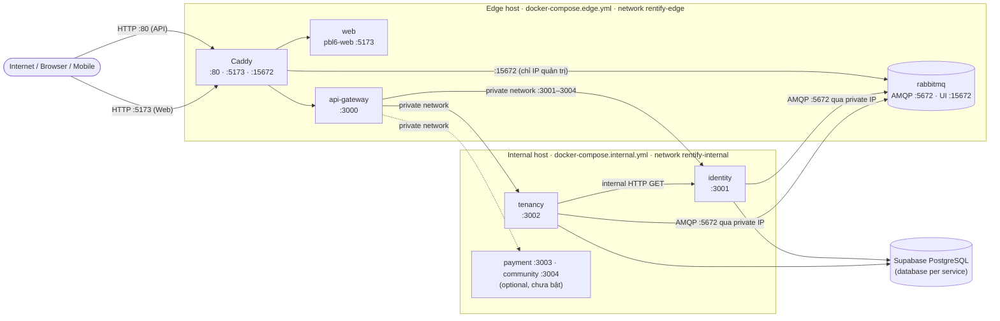

<div align="center">

<h1>Rentify · Infrastructure</h1>

<p>Cấu hình triển khai Docker Compose + Caddy cho hệ thống Rentify trên hai host AWS EC2.</p>

<p>
  
  
  
  
  
  
  
</p>

<p>
  <a href="#giới-thiệu">Giới thiệu</a> •
  <a href="#tổng-quan-kiến-trúc">Kiến trúc</a> •
  <a href="#thành-phần">Thành phần</a> •
  <a href="#triển-khai-từng-host">Triển khai</a> •
  <a href="#biến-môi-trường">Biến môi trường</a> •
  <a href="#vận-hành">Vận hành</a> •
  <a href="#bảo-mật">Bảo mật</a> •
  <a href="#đóng-góp">Đóng góp</a>
</p>

</div>

---

## Giới thiệu

Repo `infra` chứa toàn bộ cấu hình để chạy Rentify ở môi trường production. Hệ thống được tách thành **hai host EC2** dùng chung một Security Group:

- **Edge host** (public) — Caddy, Web (landlord frontend), API Gateway và RabbitMQ. Định nghĩa trong `docker-compose.edge.yml`.
- **Internal host** (backend) — Identity, Tenancy và các service tùy chọn (Payment, Community, AI). Định nghĩa trong `docker-compose.internal.yml`.

Docker image **không** được build trên server: CI/CD của từng service build image trên GitHub Actions, push lên Docker Hub, rồi SSH vào EC2 để chạy `scripts/deploy.sh` kéo image mới về. Repo này chỉ giữ compose file, Caddyfile, file env mẫu và các script vận hành.

> [!IMPORTANT]
> Các port `3000`, `3001–3004` và `5672` **không bao giờ** được mở ra Internet. Xem mục [Bảo mật](#bảo-mật).

## Tổng quan kiến trúc



Hai host **không** dùng chung Docker network. Giao tiếp khác máy đi qua private IP của EC2; địa chỉ thật chỉ nằm trong các file env trên server (không commit).

## Thành phần

| Service | Host | Image | Port nội bộ | Publish ra host | Public? |
|---|---|---|---|---|---|
| `caddy` | edge | `caddy:2-alpine` | 80, 5173, 15672 | `80`, `5173`, `15672` | `80`, `5173` công khai; `15672` chỉ IP quản trị |
| `web` | edge | `${DOCKERHUB_USERNAME:-baocules}/pbl6-web:${IMAGE_TAG:-latest}` | 5173 | — (`expose`) | Qua Caddy `:5173` |
| `api-gateway` | edge | `${DOCKERHUB_USERNAME:-baocules}/api-gateway:${IMAGE_TAG:-latest}` | 3000 | — (`expose`) | Qua Caddy `:80` |
| `rabbitmq` | edge | `rabbitmq:3-management-alpine` | 5672, 15672 | `5672` | Không — `5672` chỉ mở cho Security Group |
| `identity` | internal | `${IDENTITY_IMAGE:-baocules/identity-service}:${IMAGE_TAG:-latest}` | 3001 | `3001` | Không — chỉ Security Group |
| `tenancy` | internal | `${TENANCY_IMAGE:-baocules/tenancy-service}:${IMAGE_TAG:-latest}` | 3002 | `3002` | Không — chỉ Security Group |
| `payment` | internal | `${PAYMENT_IMAGE:-baocules/payment-service}` | 3003 | `3003` | Không (đang comment, profile `optional`) |
| `community` | internal | `${COMMUNITY_IMAGE:-baocules/community-service}` | 3004 | `3004` | Không (đang comment, profile `optional`) |

**Reverse proxy (Caddy).** `caddy/Caddyfile` định nghĩa snippet `(common)` bật nén `zstd gzip`, bỏ header `Server` và thêm `X-Content-Type-Options nosniff`, `X-Frame-Options DENY`, `Referrer-Policy strict-origin-when-cross-origin`. Ba site block:

| Listener | Upstream | Mục đích |
|---|---|---|
| `:80` | `api-gateway:3000` | API (`http://<EDGE_PUBLIC_HOST>/api/v1/...`) |
| `:5173` | `web:5173` | Landlord web |
| `:15672` | `rabbitmq:15672` | RabbitMQ Management UI |

**Healthcheck.** `api-gateway` kiểm tra `GET http://127.0.0.1:3000/health`; `rabbitmq` dùng `rabbitmq-diagnostics check_running`. Caddy chỉ khởi động sau khi RabbitMQ `service_healthy`; `tenancy` khởi động sau `identity`.

**Volume.** `caddy_data`, `caddy_config` (dữ liệu Caddy) và `rabbitmq_data` (`/var/lib/rabbitmq`) — đều trên edge host. Internal host không có volume; dữ liệu nằm trên Supabase.

> [!NOTE]
> Caddyfile hiện chỉ dùng HTTP theo port (`:80`, `:5173`), chưa gắn domain nên Caddy **không** cấp TLS tự động và không mở port `443`.

## Yêu cầu

- 2 instance EC2 Ubuntu (đang dùng loại 1 GB RAM, ví dụ `t3.micro`), cùng một Security Group.
- Docker Engine + Docker Compose plugin (cài bằng `scripts/setup-server.sh`).
- Swap 2 GB để tránh OOM (tạo bằng `scripts/setup-swap.sh`).
- Database PostgreSQL trên Supabase cho từng service.
- Image đã được push lên Docker Hub bởi workflow của từng repo service.
- `openssl` (để sinh cặp khóa JWT RS256).

## Triển khai từng host

### 1. Cài đặt ban đầu (cả hai host)

```bash
git clone <INFRA_REPOSITORY_URL> infra
cd infra
chmod +x scripts/*.sh
sudo ./scripts/setup-swap.sh      # tạo /swapfile 2 GB, vm.swappiness=10
./scripts/setup-server.sh         # cài Docker Engine + compose plugin, thêm user vào nhóm docker
cp .deploy.env.example .deploy.env
```

> [!NOTE]
> Sau `setup-server.sh`, cần logout SSH rồi đăng nhập lại để quyền nhóm `docker` có hiệu lực.

Trong `.deploy.env`, đặt stack tương ứng với từng host:

```env
# Edge host
DEPLOY_STACK=edge

# Internal host
DEPLOY_STACK=internal
```

CI/CD giả định repo được clone tại `/home/ubuntu/infra` (hoặc `~/infra`).

### 2. Edge host

```bash
cp env/rabbitmq.env.example env/rabbitmq.env
cp env/rabbitmq-users.env.example env/rabbitmq-users.env
cp env/api-gateway.env.example env/api-gateway.env
```

Trong `env/api-gateway.env`, thay placeholder bằng private IP của internal host:

```env
IDENTITY_SERVICE_URL=http://<INTERNAL_PRIVATE_HOST>:3001
TENANCY_SERVICE_URL=http://<INTERNAL_PRIVATE_HOST>:3002
PAYMENT_SERVICE_URL=http://<INTERNAL_PRIVATE_HOST>:3003
COMMUNITY_SERVICE_URL=http://<INTERNAL_PRIVATE_HOST>:3004
JWKS_URL=http://<INTERNAL_PRIVATE_HOST>:3001/api/v1/.well-known/jwks.json
CORS_ORIGINS=http://<EDGE_PUBLIC_HOST>:5173
```

Trong `env/rabbitmq-users.env`, khai báo mỗi service một dòng `<username>=<password>` (chỉ password, **không** phải `RABBITMQ_URL`). Nên dùng password chữ-số, ví dụ `openssl rand -hex 24`, để không phải URL-encode.

Deploy toàn bộ edge stack:

```bash
./scripts/deploy.sh
```

Script kiểm tra đủ file env, `pull` image, `up -d --remove-orphans`, **đồng bộ user RabbitMQ** (`scripts/sync-rabbitmq-users.sh`), `docker image prune -f` và in `ps`. Việc đồng bộ user chỉ chạy trên edge vì RabbitMQ nằm ở đây; có thể chạy lại thủ công:

```bash
bash scripts/sync-rabbitmq-users.sh
```

<details>
<summary>Cách <code>sync-rabbitmq-users.sh</code> hoạt động</summary>

- Chờ container `rabbitmq` sẵn sàng (tối đa 60 giây).
- Với mỗi dòng trong `env/rabbitmq-users.env`: tạo user nếu chưa có, hoặc đặt lại password theo file.
- Luôn cấp quyền `configure/write/read` = `.*` trên vhost `/`.
- Idempotent, không xóa user nào; tài khoản admin trong `env/rabbitmq.env` không bị đụng tới.
- Nếu không có `env/rabbitmq-users.env` thì bỏ qua.

</details>

### 3. Internal host

```bash
cp env/identity.env.example env/identity.env
cp env/tenancy.env.example env/tenancy.env
```

Sinh cặp khóa JWT RS256 cho Identity (script từ chối ghi đè nếu `private.pem`/`public.pem` đã tồn tại):

```bash
./scripts/generate-jwt-keys.sh
```

Dán hai dòng `JWT_PRIVATE_KEY` / `JWT_PUBLIC_KEY` mà script in ra vào `env/identity.env`, sau đó xóa file `.pem` khỏi server hoặc lưu ở nơi an toàn.

Trỏ RabbitMQ của từng service tới private IP của edge host, dùng đúng user/password đã khai báo trong `env/rabbitmq-users.env`:

```env
RABBITMQ_URL=amqp://<service-user>:<password>@<EDGE_PRIVATE_HOST>:5672
```

> [!WARNING]
> `env/identity.env.example` vẫn để `RABBITMQ_URL=...@rabbitmq:5672` (từ thời chạy một host). Trên internal host không có container `rabbitmq`, nên **phải** đổi sang `<EDGE_PRIVATE_HOST>`. Ngoài ra `SERVICE_TOKEN` phải giống nhau ở mọi service.

Deploy Identity và Tenancy:

```bash
./scripts/deploy.sh
```

Các service optional chỉ bật được sau khi có image, file env tương ứng **và** đã bỏ comment block `payment` / `community` trong `docker-compose.internal.yml`:

```bash
COMPOSE_PROFILES=optional DEPLOY_STACK=internal ./scripts/deploy.sh
```

### 4. Kiểm tra kết nối giữa hai host

```bash
# Từ internal host
nc -vz <EDGE_PRIVATE_HOST> 5672

# Từ edge host
nc -vz <INTERNAL_PRIVATE_HOST> 3001
nc -vz <INTERNAL_PRIVATE_HOST> 3002
```

Kết quả thành công chứa `succeeded` hoặc `open`. Nếu timeout, kiểm tra lại Security Group, private IP và UFW.

## Biến môi trường

Chỉ commit file `*.example`. File thật nằm trên server (`.deploy.env`, `env/*.env`) và bị `.gitignore` chặn — ngoại lệ duy nhất là `env/web.env` (chỉ chứa base URL public của frontend).

<details>
<summary><code>.deploy.env</code> — chọn stack & override image</summary>

| Biến | Mô tả |
|---|---|
| `DEPLOY_STACK` | `edge` hoặc `internal` (mặc định `edge`) — chọn `docker-compose.<stack>.yml` |
| `DOCKERHUB_USERNAME` | Namespace Docker Hub cho image edge (mặc định `baocules`) |
| `IMAGE_TAG` | Tag image (mặc định `latest`) |
| `IDENTITY_IMAGE`, `TENANCY_IMAGE`, `PAYMENT_IMAGE`, `COMMUNITY_IMAGE` | Override repo image của service internal |
| `COMPOSE_PROFILES` | `optional` để bật payment/community |

</details>

<details>
<summary><code>env/api-gateway.env</code> (edge)</summary>

| Biến | Mô tả |
|---|---|
| `PORT`, `NODE_ENV` | `3000`, `production` |
| `IDENTITY_SERVICE_URL`, `TENANCY_SERVICE_URL`, `PAYMENT_SERVICE_URL`, `COMMUNITY_SERVICE_URL` | Upstream trên private IP của internal host |
| `PROXY_TIMEOUT_MS` | Timeout proxy |
| `JWKS_URL`, `JWT_ISSUER`, `JWT_AUDIENCE` | Xác thực JWT — phải khớp `env/identity.env` |
| `RATE_LIMIT_WINDOW_MS`, `RATE_LIMIT_MAX`, `AUTH_RATE_LIMIT_MAX`, `REFRESH_RATE_LIMIT_MAX` | Rate limit theo IP client |
| `CORS_ORIGINS` | Origin trình duyệt được phép (phân tách bằng dấu phẩy) |

</details>

<details>
<summary><code>env/rabbitmq.env</code>, <code>env/rabbitmq-users.env</code>, <code>env/web.env</code> (edge)</summary>

| File | Biến | Mô tả |
|---|---|---|
| `rabbitmq.env` | `RABBITMQ_DEFAULT_USER`, `RABBITMQ_DEFAULT_PASS` | Tài khoản admin RabbitMQ |
| `rabbitmq-users.env` | `<username>=<password>` | Mỗi dòng một user service (`identity-service`, `tenancy-service`, `payment-service`, `community-service`) |
| `web.env` | `VITE_API_BASE_URL` | Base URL API cho frontend (không được `docker-compose.edge.yml` nạp trực tiếp) |

</details>

<details>
<summary><code>env/identity.env</code> (internal)</summary>

| Biến | Mô tả |
|---|---|
| `APP_NAME`, `PORT`, `NODE_ENV`, `LOG_LEVEL` | Cấu hình ứng dụng (`PORT=3001`) |
| `DATABASE_URL`, `DB_SSL` | Supabase PostgreSQL (pooler) |
| `RABBITMQ_URL` | `amqp://identity-service:<password>@<EDGE_PRIVATE_HOST>:5672` |
| `JWT_PRIVATE_KEY`, `JWT_PUBLIC_KEY` | PEM với `\n` literal |
| `JWT_KEY_ID`, `JWT_ISSUER`, `JWT_AUDIENCE` | Metadata JWT |
| `SERVICE_TOKEN` | Secret chung cho endpoint `internal/*` |
| `TENANCY_SERVICE_URL`, `INTERNAL_HTTP_TIMEOUT_MS` | Internal HTTP client |

</details>

<details>
<summary><code>env/tenancy.env</code> (internal)</summary>

| Biến | Mô tả |
|---|---|
| `APP_NAME`, `PORT`, `NODE_ENV`, `LOG_LEVEL` | Cấu hình ứng dụng (`PORT=3002`) |
| `JWKS_URL`, `JWT_ISSUER`, `JWT_AUDIENCE` | Xác thực JWT qua JWKS của `identity:3001` |
| `SERVICE_TOKEN` | Secret chung cho endpoint `internal/*` |
| `IDENTITY_SERVICE_URL`, `INTERNAL_HTTP_TIMEOUT_MS` | Internal HTTP client |
| `DATABASE_URL`, `MIGRATION_DATABASE_URL`, `DB_SSL` | Supabase (pooler `6543` cho runtime, `5432` cho migration) |
| `RABBITMQ_URL` | `amqp://tenancy-service:<password>@<EDGE_PRIVATE_HOST>:5672` |
| `RABBITMQ_EXCHANGE`, `RABBITMQ_EXCHANGE_TYPE` | `pbl6.events`, `topic` |
| `RABBITMQ_PREFETCH`, `RABBITMQ_CONNECT_TIMEOUT_MS`, `RABBITMQ_PUBLISH_MANDATORY` | Tham số kết nối/publish |
| `RABBITMQ_CONSUMER_MAX_ATTEMPTS`, `RABBITMQ_CONSUMER_RETRY_DELAY_MS` | Retry consumer |

</details>

## Vận hành

**Deploy một service** (chỉ pull + `up -d --no-deps` service đó; trên edge sẽ đồng bộ user RabbitMQ nếu service có dùng RabbitMQ):

```bash
DEPLOY_STACK=edge ./scripts/deploy.sh api-gateway
DEPLOY_STACK=edge ./scripts/deploy.sh web caddy
DEPLOY_STACK=internal ./scripts/deploy.sh identity
DEPLOY_STACK=internal ./scripts/deploy.sh tenancy
```

**Logs & tài nguyên:**

```bash
# Edge
docker compose -f docker-compose.edge.yml logs -f api-gateway
docker compose -f docker-compose.edge.yml logs -f rabbitmq

# Internal
docker compose -f docker-compose.internal.yml logs -f identity
docker compose -f docker-compose.internal.yml logs -f tenancy

docker stats
free -h
```

**Restart một container:**

```bash
docker compose -f docker-compose.<edge|internal>.yml restart <service>
```

**Cập nhật cấu hình Caddy** sau khi sửa `caddy/Caddyfile`:

```bash
DEPLOY_STACK=edge ./scripts/deploy.sh caddy
```

**Rollback.** Workflow hiện chỉ push tag `latest` và `deploy.sh` chạy `docker image prune -f` sau mỗi lần deploy, nên không có sẵn image cũ trên server. Để rollback: chạy lại workflow của service từ commit ổn định (hoặc push tag cố định lên Docker Hub), rồi deploy với `IMAGE_TAG` tương ứng:

```bash
IMAGE_TAG=<tag> DEPLOY_STACK=internal ./scripts/deploy.sh identity
```

### CI/CD

Repo này không có workflow riêng. Mỗi repo service có `.github/workflows/deploy.yml` (trigger khi push `main` hoặc `workflow_dispatch`) build image linux/amd64, push lên Docker Hub, rồi SSH vào EC2 và chạy:

| Repo | Image | Host | Lệnh trên server |
|---|---|---|---|
| `fe` | `pbl6-web:latest` | edge | `DEPLOY_STACK=edge bash ./scripts/deploy.sh web caddy` |
| `api-gateway` | `api-gateway:latest` | edge | `DEPLOY_STACK=edge bash ./scripts/deploy.sh api-gateway` |
| `Identity-Service` | `identity-service:latest` | internal | `DEPLOY_STACK=internal bash ./scripts/deploy.sh identity` |
| `Tenancy-Service` | `tenancy-service:latest` | internal | `DEPLOY_STACK=internal bash ./scripts/deploy.sh tenancy` |

Trước khi deploy, workflow chạy `git pull --ff-only` trong thư mục `infra` trên server — vì vậy thay đổi ở repo này có hiệu lực ở lần deploy kế tiếp của bất kỳ service nào trên host đó. Không build image trực tiếp trên EC2 1 GB RAM.

## Bảo mật

Hai EC2 dùng chung một Security Group. Với các rule nội bộ, chọn **chính Security Group đó** (ID dạng `sg-...`) làm `Source` — không nhập public/private IP, và không nhầm với Security Group Rule ID dạng `sgr-...`.

| Type | Port | Source | Mục đích |
|---|---:|---|---|
| SSH | `22` | IP quản trị của nhóm `/32` | SSH vào server |
| Custom TCP | `80` | `0.0.0.0/0` | Caddy → API Gateway |
| Custom TCP | `5173` | `0.0.0.0/0` hoặc IP demo | Caddy → Web |
| Custom TCP | `15672` | IP quản trị của nhóm `/32` | RabbitMQ Management UI |
| Custom TCP | `5672` | Security Group hiện tại | Internal host → RabbitMQ |
| Custom TCP | `3001-3004` | Security Group hiện tại | API Gateway (edge) → backend services |

<details>
<summary>Các bước nhập Source là Security Group trên AWS Console</summary>

1. **EC2** → **Security Groups** → chọn Security Group gắn cho cả hai instance → **Edit inbound rules**.
2. Chọn `Custom TCP`, nhập port `5672` hoặc `3001-3004`.
3. `Source type` = `Custom`; ở ô `Source`, nhập và chọn Security Group ID `sg-...`.
4. Kiểm tra chip `sg-...` đã xuất hiện rồi bấm **Save rules**.

</details>

> [!WARNING]
> - Không mở `3000`, `3001–3004`, `5672` hoặc `15672` cho `0.0.0.0/0`. Port `3000` chỉ là port nội bộ của API Gateway; Caddy proxy ra `80`.
> - `rabbitmq` và các service internal publish port ra host (`5672:5672`, `3001:3001`, `3002:3002`) để host kia gọi được — lớp bảo vệ duy nhất là Security Group.
> - Nếu Ubuntu bật UFW, kiểm tra cả UFW: Security Group cho phép nhưng UFW vẫn có thể chặn.
> - Nếu chỉ muốn nhóm truy cập Web, thay `0.0.0.0/0` ở port `5173` bằng IP nhóm `/32`.

**Secrets.** Không commit `.deploy.env`, `env/*.env` (trừ `env/web.env`), `DATABASE_URL`, mật khẩu RabbitMQ, `SERVICE_TOKEN`, JWT key (`private.pem`/`public.pem` đã nằm trong `.gitignore`) hoặc SSH key. Địa chỉ host thật chỉ để trong env trên server hoặc GitHub Secrets.

## Cấu trúc thư mục

```text
infra/
├── caddy/
│   └── Caddyfile                 # reverse proxy :80 / :5173 / :15672
├── env/                          # *.env.example được commit; *.env thật chỉ trên server
│   ├── api-gateway.env.example
│   ├── identity.env.example
│   ├── rabbitmq.env.example
│   ├── rabbitmq-users.env.example
│   ├── tenancy.env.example
│   ├── web.env                   # base URL API public cho frontend
│   └── web.env.example
├── scripts/
│   ├── deploy.sh                 # pull + up theo DEPLOY_STACK, sync RabbitMQ users, prune
│   ├── generate-jwt-keys.sh      # sinh cặp khóa RS256 cho Identity
│   ├── setup-server.sh           # cài Docker Engine + compose plugin (Ubuntu)
│   ├── setup-swap.sh             # tạo swap 2 GB
│   └── sync-rabbitmq-users.sh    # tạo/cập nhật user RabbitMQ cho từng service
├── docker-compose.edge.yml
├── docker-compose.internal.yml
├── .deploy.env.example
└── INSTRUCTION.md                # hướng dẫn triển khai chi tiết
```

## Đóng góp

- Luồng nhánh: `main` ← `develop` ← `feature/<id>-<slug>` (cùng các tiền tố `fix/`, `hotfix/`, `docs/`, `ci/`). Task ID theo `pm/phase-N/issues/`, ví dụ `feature/p6-08-<slug>`.
- Không push trực tiếp lên `main` / `develop`; mở Pull Request, cần **≥ 1 reviewer**, merge bằng **squash**.
- Commit message bằng tiếng Anh theo [Conventional Commits](https://www.conventionalcommits.org/), ví dụ `feat(deploy): ...`, `fix: ...`, `docs: ...`, `chore: ...`.
- Mọi thay đổi trên `main` sẽ được server kéo về (`git pull --ff-only`) ở lần deploy kế tiếp — kiểm tra kỹ compose/script trước khi merge.
- Tuyệt đối không commit IP thật, secret hay file env thật.

## Hệ sinh thái Rentify

| Repo | Vai trò |
|---|---|
| [`api-gateway`](https://github.com/pbl6-home-renter/api-gateway) | Reverse proxy: định tuyến theo prefix, xác thực JWT/JWKS, rate limit |
| [`Identity-Service`](https://github.com/pbl6-home-renter/Identity-Service) | Xác thực, người dùng, hồ sơ chủ trọ; phát hành JWT RS256 |
| [`Tenancy-Service`](https://github.com/pbl6-home-renter/Tenancy-Service) | Tòa nhà, phòng, đơn vị hành chính |
| [`boilerplate`](https://github.com/pbl6-home-renter/boilerplate) | Template NestJS mà mọi backend service được fork từ |
| [`be`](https://github.com/pbl6-home-renter/be) | Hợp đồng OpenAPI 3.0 chuẩn (canonical) |
| [`fe`](https://github.com/pbl6-home-renter/fe) | Web cho chủ trọ (React + Vite) |
| [`mobile`](https://github.com/pbl6-home-renter/mobile) | Ứng dụng Android cho người thuê & chủ trọ |
| [**`infra`**](https://github.com/pbl6-home-renter/infra) | Docker Compose + Caddy cho hai host EC2 |

## Giấy phép

Dự án học thuật thuộc học phần PBL6 — Trường Đại học Bách khoa, Đại học Đà Nẵng. Chưa phát hành theo giấy phép mã nguồn mở.
